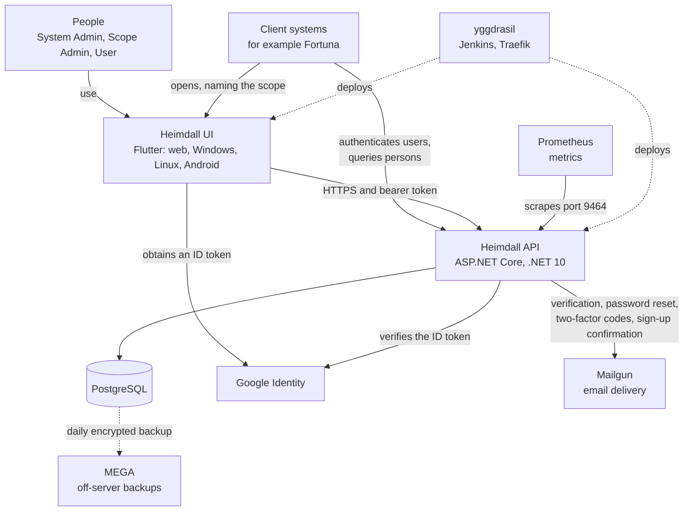
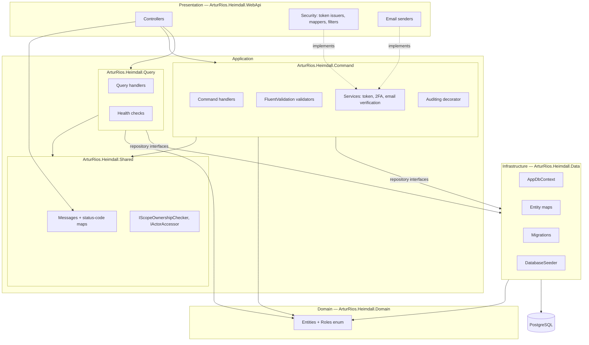
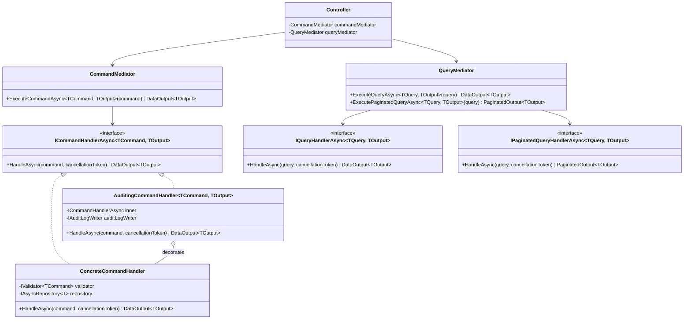
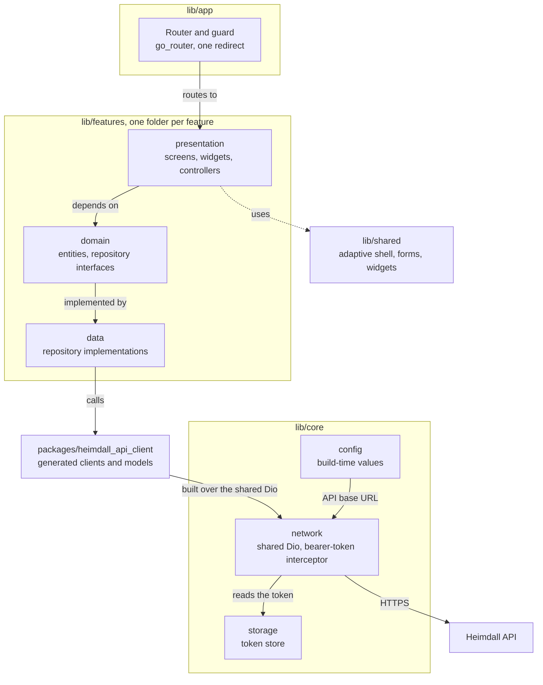
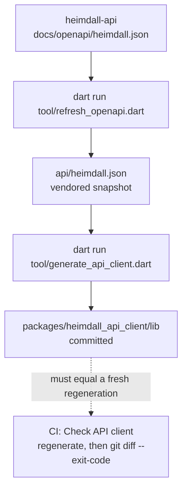
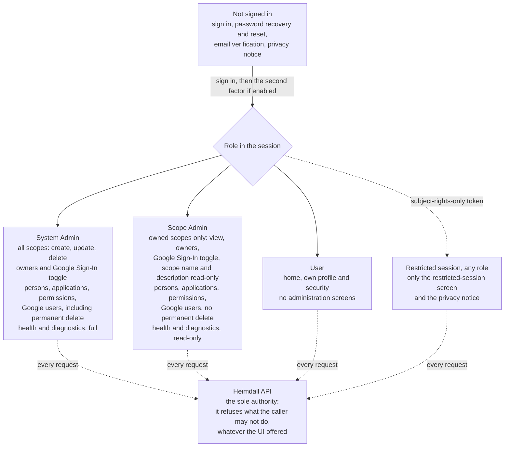

This page shows how the pieces of Heimdall fit together. It has four views:
the system and what surrounds it, the layers inside the API, the structure of
the UI, and the role-based behaviour of the UI. The terms (scope, role, person,
application) are explained in the [Overview]().

The API's entities, their relationships and the deletion cascades are on their
own page, the [Domain model]().

## System context

Heimdall is two programs and a database, with a few services around them. Client
systems are the systems that delegate their people and their sign-in to
Heimdall. [Fortuna](https://docs.artur-rios.tech/fortuna-docs/) is one of them.



- **Heimdall UI** is the interface for the three roles. It talks to the
  API over HTTPS with a bearer token, and to Google Identity only to obtain an
  ID token for Google Sign-In. On the web, a client system opens the UI
  and names the scope it wants to act in (see [Configuration](#configuration-and-secure-storage)
  below).
- **Heimdall API** is the system of record and the only authority on data and
  authorization. A client system calls it to authenticate its users and to query
  persons. For Fortuna, the sources add two details: `fortuna-api` holds no
  signing secret of Heimdall's, because Heimdall signs its tokens with ES256 and
  publishes the public keys at `/.well-known/jwks.json`, which is what Fortuna
  verifies them against (see [Signing key](../api/operations/#signing-key)); and
  API 1.4.0 lets a client system send
  `X-Heimdall-Caller-Key` and `X-Heimdall-Client-Address` so that the rate
  limiter counts each of its users under their own address instead of counting
  them all under the client system's address. How a client system connects is
  covered in the [Integrating a client system]() section.
- **PostgreSQL** is the only data store, in every environment. The API reaches it
  through EF Core.
- **Google Identity** is used for Google Sign-In. The UI obtains a Google ID
  token and sends it to the API. The API validates it offline against cached
  public certificates, and the token is never sent to Google.
- **Mailgun** delivers the API's emails through `ArturRios.Messaging`, using the
  US region. Where Mailgun is not configured, a non-Production API logs the
  tokens instead, and a Production API refuses to start.
- **Prometheus** scrapes the API's metrics from port 9464, which is reachable
  only on a private network.
- **MEGA** holds the database's daily encrypted backups, kept for 35 days. It is
  hosting, not application configuration.
- **yggdrasil** is the deployment tooling (Jenkins and Traefik). It
  deploys the development, homologation and production environments on one VPS.
  Traefik routes `/api/` on the UI's host to that environment's API, so the
  browser build makes no cross-origin request. In the local setup, the UI runs
  on `http://localhost:8081` and the API on `http://localhost:8080`.

The deployment details are in
[Environments and deployment]()
and the API's [Operations]() page.

## API layers

The API is a layered (DDD-flavoured) solution with **CQRS** in the application
layer: reads and writes travel through different objects, different mediators
and different handlers.



| Layer | Project | What it holds |
| --- | --- | --- |
| **Domain** | `ArturRios.Heimdall.Domain` | The entities and the `Roles` enum, with no behaviour beyond their data shape. It depends on nothing. See the [Domain model](). |
| **Application** | `ArturRios.Heimdall.Command` | The write side: commands, validators, handlers, the application services for tokens, two-factor authentication and email verification, and the auditing decorator. |
| | `ArturRios.Heimdall.Query` | The read side: queries, validators, handlers, health checks and output DTOs. |
| | `ArturRios.Heimdall.Shared` | The cross-cutting contracts both sides use: the messages and status-code maps, `IScopeOwnershipChecker` and `IActorAccessor`. |
| **Infrastructure** | `ArturRios.Heimdall.Data` | `AppDbContext`, the entity maps, the migrations and the database seeder, over PostgreSQL. |
| **Presentation** | `ArturRios.Heimdall.WebApi` | The controllers, JWT issuing and validation, the filters, the email and Google adapters, and start-up. |

The arrows only ever point inwards or sideways: **Domain depends on nothing**,
and the application layer depends on Infrastructure only through repository
*interfaces* (`IAsyncRepository<T, long>`, `IAsyncReadOnlyRepository<T, long>`)
that Infrastructure implements. Presentation supplies the concrete adapters for
the abstractions the application layer declares (`IAuthTokenIssuer`,
`IEmailVerificationSender`, `IGoogleIdTokenVerifier`), which is why swapping
Mailgun for logging, or the real Google verifier for the refusing one, is a
start-up registration decision and nothing else.

### CQRS: two mediators, two shapes



A controller action is deliberately thin — bind, dispatch, resolve:

```csharp
[HttpPost]
[RoleRequirement((int)Roles.SystemAdmin)]
public async Task<ActionResult<DataOutput<CreateScopeCommandOutput?>>> Create(
    [FromBody] CreateScopeCommand command)
{
    var result = await commandMediator
        .ExecuteCommandAsync<CreateScopeCommand, CreateScopeCommandOutput>(command);

    return result.ToActionResult(statusMap: ScopeMessageMap.StatusCodes);
}
```

No business rule lives in a controller. The handler returns a `DataOutput<T>` carrying data,
messages, and errors; Util.WebApi's `ToActionResult` turns that into an HTTP status using the per-area
**message map** — a dictionary from message text to status code — so "which error is a 404 and which
is a 409" is a single table per area rather than scattered `return NotFound()` calls.

### Auditing by decoration

Every write handler is registered through `AddAuditedCommandHandler`, which registers the concrete
handler and then registers the *interface* as an `AuditingCommandHandler` wrapping it (**NFR-09**):

```csharp
services.AddScoped<THandler>();
services.AddScoped<ICommandHandlerAsync<TCommand, TOutput>>(provider =>
    new AuditingCommandHandler<TCommand, TOutput>(
        provider.GetRequiredService<THandler>(),
        provider.GetRequiredService<IAuditLogWriter>(),
        provider.GetRequiredService<ILogger<AuditingCommandHandler<TCommand, TOutput>>>()));
```

The decorator writes one `AuditLog` row per **successful** command, resolving the target from the
output's `Id`/`PublicId` by reflection and the actor from `IActorAccessor` (the current request's
identity). A failure to write the audit entry is logged as a warning and never fails the request the
user already succeeded at.

{}
The concrete `THandler` registration exists only so the decorator factory can resolve it. Resolving
`THandler` directly silently bypasses auditing — always depend on
`ICommandHandlerAsync<TCommand, TOutput>`.
{}

See [Audit logging]() for the sequence.

### How a failure becomes a status

`ToActionResult` resolves the HTTP status from the envelope's first error (or, on success, its
first message) against the map the controller passes it, falling back to 200 on success and 400 on
failure. Each use case owns a `*MessageMap` naming its own outcomes — `InvalidCredentials` is a 401,
`EmailAlreadyExists` a 409, and so on.

Persistence failures are not the use case's vocabulary, and until recently they had none of their
own: a repository handed back the provider's text, which named the violated index, the conflicting
value, or the column and its type. Nothing stable could be keyed off that, so every one of them fell
through to the 400 default — a duplicate that lost a race and a database that had gone away were
both reported as bad requests, and the message leaked schema detail to the caller.

`ArturRios.Data.Relational.Core` (since 4.0.0) classifies each failure into one of five fixed, caller-safe
messages instead, reading the provider text only to decide which. `DataAccessMessageMap` folds four
of them into every use case's map:

| Classified failure | Status |
| --- | --- |
| Unique violation | 409 Conflict |
| Other integrity rule (FK, NOT NULL, CHECK) | 409 Conflict |
| Concurrency conflict | 409 Conflict |
| Transient — the store is unavailable | 503 Service Unavailable |

The fifth, the unclassified `A data-access error occurred.`, is deliberately left unmapped and keeps
the 400 default. It covers both causes a caller can fix — a value longer than its column, where a
validator failed to bound it — and causes only an operator can, so neither 400 nor 500 fits all of
it, and 400 is the safer of the two.

A use case's own entries always win over these, so a map assembled this way can never override the
vocabulary the use case defines.

### The HTTP request pipeline

```mermaid
graph LR
    REQ([Request]) --> FWD["Forwarded headers<br/>trusted proxies only"]
    FWD --> HTTPS[HTTPS redirect]
    HTTPS --> TRACE[TraceActivityMiddleware]
    TRACE --> EX[ExceptionMiddleware]
    EX --> CORS["CORS<br/>configured origins only"]
    CORS --> AUTHN[AuthenticationMiddleware]
    AUTHN --> RL[Rate limiter<br/>credential-checking endpoints only]
    RL --> MFA[MfaPendingGuardFilter]
    MFA --> SRO[SubjectRightsOnlyGuardFilter]
    SRO --> LIVE[ActorLivenessFilter]
    LIVE --> ROLE["RoleRequirement /<br/>AllowAnonymous"]
    ROLE --> CTRL[Controller action]
    CTRL --> MED[Mediator]
    MED --> H[Handler]
    H --> DB[(PostgreSQL)]
    H --> RES[DataOutput]
    RES --> RR["ToActionResult<br/>+ message map"]
    RR --> RESP([HTTP response])
```



Everything from `TraceActivityMiddleware` to `AuthenticationMiddleware` is Util.WebApi's standard
pipeline, which `Startup` derives from `WebApiStartup` to get. What it has no place for is added
around it: the metrics scrape branch (on its own port, ahead of everything — see
[Metrics](../api/operations/#metrics--prometheus)), forwarded headers and HTTPS redirection go in
front through a startup filter, and the rate limiter goes after it. `TraceActivityMiddleware` logs
every request with the caller's IP address — the real caller's when `HEIMDALL_TRUSTED_PROXIES` names
the proxy in front of the API, the proxy's otherwise.

{}
`Startup.Build()` registers `ExceptionMiddleware`, then `UseSwagger()`, then
`AuthenticationMiddleware` — not both middlewares before Swagger. Authentication does not exempt the
Swagger routes, so registering it first answered 401 to every request for `/swagger`, `index.html`
included, which no browser can satisfy. Keeping the exception middleware ahead means a failure inside
Swagger still answers the usual JSON envelope.

Swagger is registered only in the environments the library allows, and in Production it registers
nothing at all — so this does not publish the document from a production instance.
{}

Several things about this pipeline are worth knowing before reading any handler:

**Authentication reads no database.** `AddTokenAuthentication<IdentityUserMapper>` is configured with
`JwtValidationMode.ClaimsOnly` and `TokenSource.Header`: the `IdentityUser` is rebuilt from the
token's claims alone, and nothing is looked up while the token is validated. The library's validator
checks the signature (ES256 only) and lifetime; `PersonTokenValidator` takes its place, wrapping it,
and also requires `HEIMDALL_AUTH_TOKEN_ISSUER` and exactly one of the three person audiences
(**NFR-30**), so a correctly signed token Heimdall did not issue for itself is refused like a forged
one.

**Tokens are signed with ES256 and the keys are published.** `TokenSigningKeys` reads
`HEIMDALL_AUTH_SIGNING_KEY` (and `_PREVIOUS` during a rotation) once at start-up and refuses to start
without a usable P-256 key. The current key signs every token, with its RFC 7638 thumbprint as the
`kid`; the previous key is only published and accepted. `GET /.well-known/jwks.json` serves the
public halves, so consumers verify tokens without holding anything secret. The ES256 configuration
accepts ES256 only, so every reader refuses an HS256 token: the shared secret Heimdall signed with
before 3.0.0 is retired, and 4.0.0 no longer reads it (Threat Model TH-43). Generating and rotating
the key is covered in [Signing key](../api/operations/#signing-key).

**But the identity it names is checked.** `ActorLivenessFilter` runs globally, right after the
challenge-token guard, and refuses a token whose person or Google User is absent or logically
deleted (**FR-AU-05**, **FR-GO-12**). Without it, `ClaimsOnly` meant a token kept working for its
whole lifetime after the account behind it was deleted — and the handlers compensated unevenly:
`ScopeOwnershipChecker` excluded a deleted Scope Admin, while every System Admin bypass and every
"acting on yourself" branch trusted the role claim alone, leaving the protection in place for the
lesser role and absent for the greater one. It costs one indexed read per authenticated request, and
two for a Google User, since the token does not say which table its subject lives in. A restricted
identity (**NFR-24**) is refused the same way — except on the four actions marked
`[DataSubjectRight]` (export, erasure request, restriction, lifting one's own restriction), where a
restricted or suspended subject still reaches the handler and the use case's own flows answer.

**Single-use state is spent in the database, not in memory.** The repositories write whole rows —
read, change, save — so two requests that read the same recovery code, token, challenge or counter
before either saved would both act on it. `IAtomicWrites` (Domain, implemented in Data on
`ExecuteUpdate`) makes each of those a single conditional `UPDATE … WHERE` whose affected-row count
says who won, and charges every guess budget before the comparison it guards.

**A person's state is written column by column.** The same whole-row save would write every column
of a person back as the request read it, so a profile edit racing a restriction, a deletion or a
lockout could undo it. The mapping therefore lets a whole-row save write a person's plain profile
only — the name, the recorded basis and `UpdatedAt`. The address and its verified flag, the role and
scope, the login lockout, and the deletion, erasure, restriction and anonymisation columns are each
changed by a targeted write in `IAtomicWrites`, conditional on the state the change starts from: a
restriction only while there is none, a deletion only of a live person, an address or role change
only while the person still holds the address and role the request read (#237). Ownership rows are
added and removed the same way, so neither writes the person at all. The plain profile is targeted
too: UC-08 writes the name and `UpdatedAt` only while the person is not deleted, and a promotion
removes the membership row beside the role, so neither saves the person whole (#205). A Google
User's deletion, erasure, restriction and anonymisation columns are mapped and written the same way
as a person's. A scope's details, its deletion flag and each of its settings with an endpoint of its
own — Google sign-in, self-registration and the email links — are written by targeted writes too,
each of its own columns and only while the scope is not deleted, so none writes back another's or
revives a deleted scope.

**One class owns both directions of the claims.** `IdentityUserMapper` writes the claims when a token
is issued and reads them when one is validated, so the two cannot drift. Every claim value is a
`PublicId`; an internal `bigint` never reaches a token (**NFR-15**).

**A challenge token is inert everywhere but one endpoint.** `MfaPendingGuardFilter` is registered
globally and rejects any request whose identity carries `MfaPending` with a 401 (**FR-2F-10**,
**NFR-17**). The second-factor endpoint itself is unaffected because it is `[AllowAnonymous]` and
takes the challenge token as a *body field*, never as a bearer credential. The token also carries an
audience of its own, `HEIMDALL_AUTH_TOKEN_AUDIENCE` + `.2fa-challenge`, so a consumer that pins the
person audience refuses it, and `IdentityUserMapper` reads `mfaPending` only under that audience.

**A subject-rights-only token is confined to four actions.** A restricted identity that signs in
(**NFR-24**, UC-11 AF-11i, UC-25 AF-25e) is issued a token carrying the `subjectRightsOnly` claim
and no scope, under its own audience, `HEIMDALL_AUTH_TOKEN_AUDIENCE` + `.subject-rights`, which
consumers pinning the person audience refuse. `SubjectRightsOnlyGuardFilter`, registered globally
after the challenge-token guard, answers it `403` on every action not marked `[DataSubjectRight]` —
on its claims alone, before the liveness check's read. The liveness check would refuse it there too
while the restriction stands; the guard keeps it confined after the restriction is lifted, so a lift
never turns it into a full token.

### Authorization

Role checks are declarative, via `[RoleRequirement]` on the action:

```csharp
[HttpDelete("{id:guid}/hard")]
[RoleRequirement((int)Roles.SystemAdmin)]
```

Ownership checks — "is this Scope Admin an owner of *this* scope?" — cannot be expressed in an
attribute, so they live behind `IScopeOwnershipChecker`, resolved inside the handler. A handful of
endpoints carry **no** role attribute on purpose: `GET /api/scopes/{scopeId}/google-users/{id}`, for
example, must admit the Google User themselves, whose token is `User`-role, so any attribute strong
enough to exclude other users would exclude the actor the use case grants.

The complete matrix — every action against every role — is §7 of the
[System Requirements Document](../api/requirements/documents/system-requirements-document/),
summarised per endpoint in the [API reference]().

### Validation

Input validation is FluentValidation, one validator per command or query, registered alongside its
handler (**NFR-10**). Where a command has no validator it is a documented decision, not an omission —
the start-up registrations carry the reason inline. The two recurring reasons:

- **Nothing to validate.** Every field is a typed route value already constrained by the route
  (`{id:guid}`), or the request carries no caller-supplied input at all because the subject comes
  from the bearer token.
- **The rule needs the database.** Which second factor is required depends on the stored
  `AppEnabled`/`EmailEnabled` of the person's configuration — a read only the handler can make.

Every paginated list query *does* have a validator, so page size and filters are checked before a
query reaches the database.

### Persistence

`AppDbContext` applies one **entity map** per entity (`PersonDbMap`, `ScopeDbMap`, …) rather than
annotating the domain classes, keeping storage concerns out of the domain. Handlers never touch the
context: they depend on `IAsyncRepository<T, long>` for writes and `IAsyncReadOnlyRepository<T, long>`
for reads, the latter exposing `Query()` so a handler can compose an `IQueryable` and let the
database do the filtering.

EF diagnostics — sensitive data logging and detailed errors — are enabled outside Production only;
they would otherwise print parameter values including password hashes, salts, and email addresses.
On an instance that serves a public host they stay off outside Production too, unless
`HEIMDALL_ALLOW_SENSITIVE_DIAGNOSTICS` says the instance holds made-up people only (see
[Diagnostics on a public host](../api/operations/#diagnostics-on-a-public-host--nfr-28)).

The entities, their relationships and the deletion cascades are on the
[Domain model]() page. The same pipeline is traced end
to end for specific use cases under [Flows](), and migrations, health
checks, logging and rate limiting are covered in [Operations]().

## UI architecture

Heimdall UI is a Flutter application with one codebase for the web, Windows,
Linux and Android. It follows a feature-first layout, and each feature is split
into `presentation`, `domain` and `data`.



| Concern | How the UI does it |
| --- | --- |
| **State and dependency injection** | `flutter_riverpod`. Providers are the only global wiring, and each feature owns its own. `Notifier` and `AsyncNotifier` back the session and the theme mode. At start-up, `main.dart` builds each repository from a generated client over the shared Dio instance. Riverpod's automatic retry is switched off, so a failure is shown once and the user decides whether to try again. |
| **Routing and the role guard** | `go_router`, with a single redirect that guards every route by session and role. The web build routes on the path, not the hash, so links in emails such as `/password-reset?token=...` land on the right screen. |
| **HTTP** | One `dio` instance shared by every generated client. Its interceptor attaches the bearer token and, when the API rejects the session token with a `401`, clears the session and sends the person to sign-in. A `403` leaves the session alone. |
| **Generated API client** | The package `packages/heimdall_api_client`, produced by `swagger_parser`, `build_runner`, `json_serializable` and `retrofit_generator` from `api/heimdall.json`. Its clients are `AuthClient`, `ScopeClient`, `PersonClient`, `ApplicationClient`, `ScopePermissionClient`, `GoogleUserClient` and `HealthCheckClient`. It is never edited by hand. |
| **Boundary rule** | Presentation code never imports the generated package. It depends on the domain's repository interfaces, and only `data/` knows the generated types exist. |
| **Errors** | The `errors` array of the API's response envelope is shown as the API returned it, not replaced with invented text. |
| **Layout** | Material 3, in light and dark. The shell adapts to compact (under 600), medium (600 to 1024) and expanded (over 1024) widths. |

### The generated client

`api/heimdall.json` is a vendored snapshot of the API's OpenAPI document. The
generated client is committed, so a normal checkout needs no generation step.
When the API's specification changes, the snapshot and the client are refreshed
together, and a CI check fails when they disagree.



The generation command does three things in order: it runs `swagger_parser`
over the snapshot, runs `build_runner` inside the package to emit the `.g.dart`
files, and runs `dart format` over the package. The pipeline is deterministic,
which is what makes the CI check meaningful: the **Check API client** workflow
runs `dart run tool/generate_api_client.dart` and then
`git diff --exit-code -- packages/heimdall_api_client`.

The commands for refreshing the snapshot from a local API checkout are in the
UI's
[CONTRIBUTING.md](https://github.com/artur-rios/heimdall-ui/blob/main/CONTRIBUTING.md#generated-api-client).

### Configuration and secure storage

**Configuration is supplied at build time** through `--dart-define`. Nothing is
read from a file at runtime, and no deployment address is stored in the
repository.

| Key | Purpose |
| --- | --- |
| `HEIMDALL_API_BASE_URL` | The API root. Defaults to `http://localhost:8080`. |
| `HEIMDALL_GOOGLE_CLIENT_ID` | The Google client ID. When it is unset, the Google control is hidden. |
| `HEIMDALL_SCOPE_ID` | The scope this build acts in, used when no calling application names one. |

The UI never asks for a scope. How a calling web application names it, and what
the other platforms use, is under
[The target scope]().

**The bearer token is the only state the UI keeps**, and it is held in secure
storage (`flutter_secure_storage`):

| Platform | Where the token is held |
| --- | --- |
| Android | Keystore |
| Windows | DPAPI |
| Linux | libsecret |
| Web | WebCrypto-encrypted local storage |

Signing out deletes the token, and a two-factor challenge token is never stored.
`shared_preferences` holds only the chosen theme mode and never a token.

## Role-based UI

What the UI shows follows the role in the session. The role comes from the
token, and a single guard checks it on every route. A route that the role cannot
reach leads to a screen saying so, not to a loop.



Every signed-in role, except a restricted session, also gets the home screen,
its own profile and the two-factor settings. The full table of which role reaches which screen is in the
UI's
[System Requirements Document]().

{}
Showing or hiding a screen is a usability decision, never a security control.
The UI holds no identity data of its own and enforces no rule the API does not.
If a request is one the API refuses, it is refused whatever the UI offered. A
rule that is wrong in the UI shows the wrong menu and grants nothing.
{}

A restricted session is one holding the subject-rights-only token that the API
issues to an identity whose processing is restricted. The UI confines it to the
restricted-session screen and the privacy notice, whatever the role.
