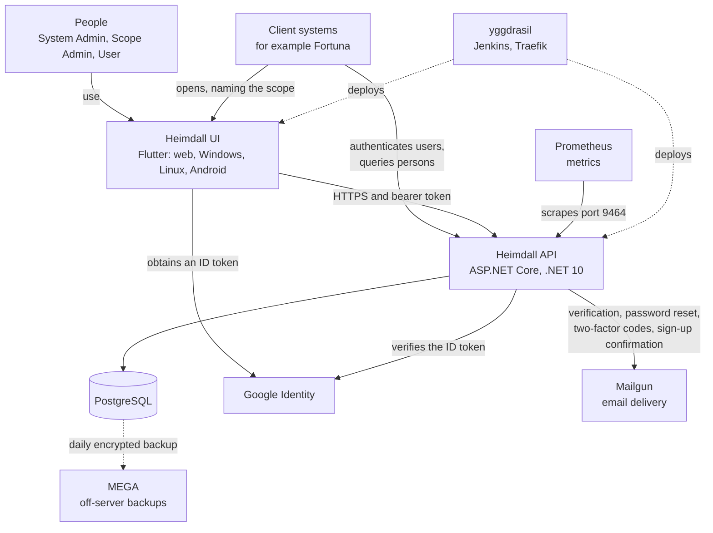
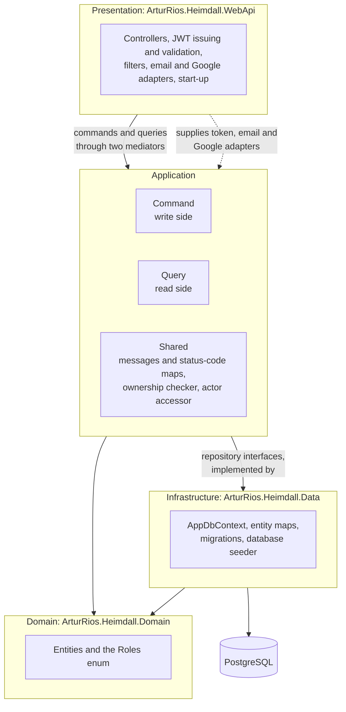
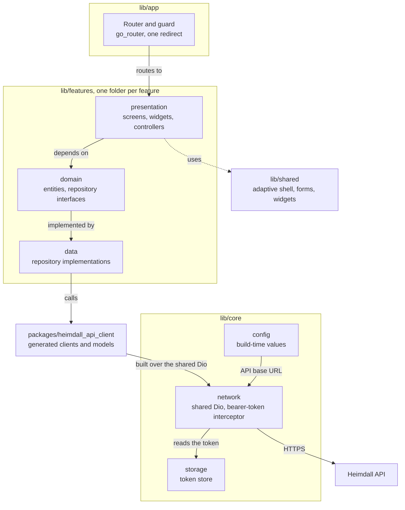
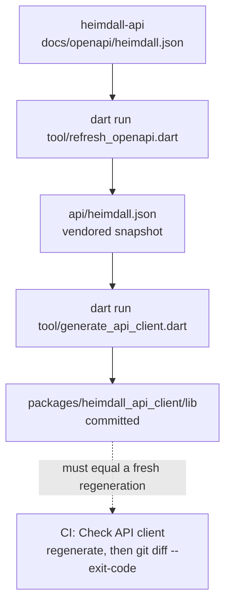
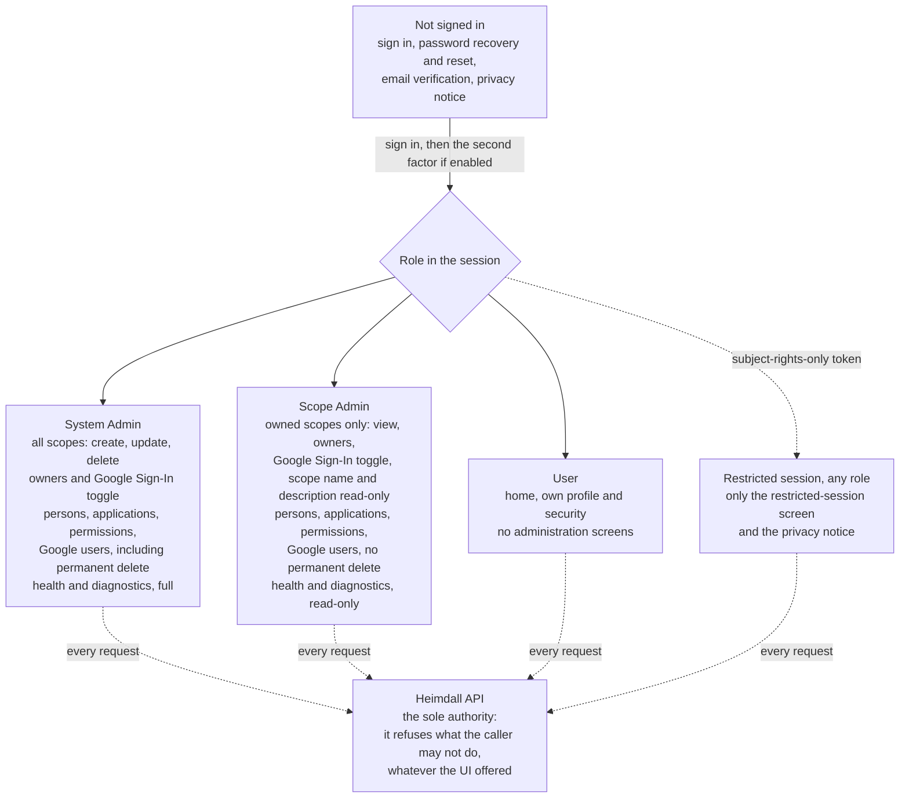

This page shows how the pieces of Heimdall fit together. It has four views:
the system and what surrounds it, the layers inside the API, the structure of
the UI, and the role-based behaviour of the UI. The terms (scope, role, person,
application) are explained in the [Overview]().

The API keeps the detailed architecture of its own code. This page summarises
it and links to the API's documentation for the rest.

## System context

Heimdall is two programs and a database, with a few services around them. Client
systems are the systems that delegate their people and their sign-in to
Heimdall. [Fortuna](https://docs.artur-rios.tech/fortuna-docs/) is one of them.

- **Heimdall UI** is the interface for the three roles. It talks to the
  API over HTTPS with a bearer token, and to Google Identity only to obtain an
  ID token for Google Sign-In. On the web, a client system opens the UI
  and names the scope it wants to act in (see [Configuration](#configuration-and-secure-storage)
  below).
- **Heimdall API** is the system of record and the only authority on data and
  authorization. A client system calls it to authenticate its users and to query
  persons. For Fortuna, the sources add two details: in each VPS environment
  `fortuna-api` is given the same `HEIMDALL_AUTH_TOKEN_SECRET` value as that
  environment's Heimdall API, and API 1.4.0 lets a client system send
  `X-Heimdall-Caller-Key` and `X-Heimdall-Client-Address` so that the rate
  limiter counts each of its users under their own address instead of counting
  them all under the client system's address. How a client system connects is
  covered in the [Integrating a client system]() section.
- **PostgreSQL** is the only data store, in every environment. The API reaches it
  through EF Core.
- **Google Identity** is used for Google Sign-In. The UI obtains a Google ID
  token and sends it to the API. The API validates it offline against cached
  public certificates, and the token is never sent to Google.
- **Mailgun** delivers the API's emails through `ArturRios.Messaging`, using the
  US region. Where Mailgun is not configured, a non-Production API logs the
  tokens instead, and a Production API refuses to start.
- **Prometheus** scrapes the API's metrics from port 9464, which is reachable
  only on a private network.
- **MEGA** holds the database's daily encrypted backups, kept for 35 days. It is
  hosting, not application configuration.
- **yggdrasil** is the deployment tooling (Jenkins and Traefik). It
  deploys the development, homologation and production environments on one VPS.
  Traefik routes `/api/` on the UI's host to that environment's API, so the
  browser build makes no cross-origin request. In the local setup, the UI runs
  on `http://localhost:8081` and the API on `http://localhost:8080`.

The deployment details are in the API's
[environments and deployment](https://docs.artur-rios.tech/heimdall-api/docs/environments-and-deployment/)
page and its
[operations](https://docs.artur-rios.tech/heimdall-api/docs/operations/) page.

## API layers

The API is a layered solution with CQRS in the application layer: reads and
writes travel through different objects, different mediators and different
handlers.

| Layer | What it holds |
| --- | --- |
| **Domain** | The entities and the `Roles` enum. It depends on nothing. |
| **Application** | The behaviour. **Command** is the write side (commands, validators, handlers, services for tokens, two-factor authentication and email verification, and the auditing decorator). **Query** is the read side (queries, validators, handlers, health checks). **Shared** holds the messages and status-code maps, `IScopeOwnershipChecker` and `IActorAccessor`. |
| **Infrastructure** | `AppDbContext`, the entity maps, the migrations and the database seeder, over PostgreSQL. |
| **Presentation** | The controllers, JWT issuing and validation, the filters, the email and Google adapters, and start-up. |

The arrows only ever point inwards or sideways: Domain depends on nothing.
The application layer depends on Infrastructure only through repository
interfaces that Infrastructure implements, and Presentation supplies the
adapters for the abstractions the application layer declares. Every write
handler is wrapped by an auditing decorator that writes one audit log row per
successful command. A failure to write that row is logged as a warning and
never fails the request.

The API's own [Architecture page](https://docs.artur-rios.tech/heimdall-api/docs/architecture/)
goes further: the CQRS mediators, the auditing decorator and the HTTP request
pipeline.

## UI architecture

Heimdall UI is a Flutter application with one codebase for the web, Windows,
Linux and Android. It follows a feature-first layout, and each feature is split
into `presentation`, `domain` and `data`.

| Concern | How the UI does it |
| --- | --- |
| **State and dependency injection** | `flutter_riverpod`. Providers are the only global wiring, and each feature owns its own. `Notifier` and `AsyncNotifier` back the session and the theme mode. At start-up, `main.dart` builds each repository from a generated client over the shared Dio instance. Riverpod's automatic retry is switched off, so a failure is shown once and the user decides whether to try again. |
| **Routing and the role guard** | `go_router`, with a single redirect that guards every route by session and role. The web build routes on the path, not the hash, so links in emails such as `/password-reset?token=...` land on the right screen. |
| **HTTP** | One `dio` instance shared by every generated client. Its interceptor attaches the bearer token and, when the API rejects the session token with a `401`, clears the session and sends the person to sign-in. A `403` leaves the session alone. |
| **Generated API client** | The package `packages/heimdall_api_client`, produced by `swagger_parser`, `build_runner`, `json_serializable` and `retrofit_generator` from `api/heimdall.json`. Its clients are `AuthClient`, `ScopeClient`, `PersonClient`, `ApplicationClient`, `ScopePermissionClient`, `GoogleUserClient` and `HealthCheckClient`. It is never edited by hand. |
| **Boundary rule** | Presentation code never imports the generated package. It depends on the domain's repository interfaces, and only `data/` knows the generated types exist. |
| **Errors** | The `errors` array of the API's response envelope is shown as the API returned it, not replaced with invented text. |
| **Layout** | Material 3, in light and dark. The shell adapts to compact (under 600), medium (600 to 1024) and expanded (over 1024) widths. |

### The generated client

`api/heimdall.json` is a vendored snapshot of the API's OpenAPI document. The
generated client is committed, so a normal checkout needs no generation step.
When the API's specification changes, the snapshot and the client are refreshed
together, and a CI check fails when they disagree.

The generation command does three things in order: it runs `swagger_parser`
over the snapshot, runs `build_runner` inside the package to emit the `.g.dart`
files, and runs `dart format` over the package. The pipeline is deterministic,
which is what makes the CI check meaningful: the **Check API client** workflow
runs `dart run tool/generate_api_client.dart` and then
`git diff --exit-code -- packages/heimdall_api_client`.

The commands for refreshing the snapshot from a local API checkout are in the
UI's
[CONTRIBUTING.md](https://github.com/artur-rios/heimdall-ui/blob/develop/CONTRIBUTING.md#generated-api-client).

### Configuration and secure storage

**Configuration is supplied at build time** through `--dart-define`. Nothing is
read from a file at runtime, and no deployment address is stored in the
repository.

| Key | Purpose |
| --- | --- |
| `HEIMDALL_API_BASE_URL` | The API root. Defaults to `http://localhost:8080`. |
| `HEIMDALL_GOOGLE_CLIENT_ID` | The Google client ID. When it is unset, the Google control is hidden. |
| `HEIMDALL_SCOPE_ID` | The scope this build acts in, used when no calling application names one. |

The UI never asks for a scope. On the web, the calling application writes the
scope's public ID into session storage before sending the user to the UI, with
`sessionStorage.setItem('heimdall.scopeId', '<scope-public-id>')`. The value is
read on every use, it dies with the tab, and `HEIMDALL_SCOPE_ID` is the fallback.
On Windows, Linux and Android there is no calling web application, so
`HEIMDALL_SCOPE_ID` is the whole answer.

**The bearer token is the only state the UI keeps**, and it is held in secure
storage (`flutter_secure_storage`):

| Platform | Where the token is held |
| --- | --- |
| Android | Keystore |
| Windows | DPAPI |
| Linux | libsecret |
| Web | WebCrypto-encrypted local storage |

Signing out deletes the token, and a two-factor challenge token is never stored.
`shared_preferences` holds only the chosen theme mode and never a token.

## Role-based UI

What the UI shows follows the role in the session. The role comes from the
token, and a single guard checks it on every route. A route that the role cannot
reach leads to a screen saying so, not to a loop.

Every signed-in role, except a restricted session, also gets the home screen,
its own profile and the two-factor settings. The full table of which role reaches which screen is in the
UI's
[System Requirements Document](https://github.com/artur-rios/heimdall-ui/blob/develop/docs/requirements/System%20Requirements%20Document.md).

{}
Showing or hiding a screen is a usability decision, never a security control.
The UI holds no identity data of its own and enforces no rule the API does not.
If a request is one the API refuses, it is refused whatever the UI offered. A
rule that is wrong in the UI shows the wrong menu and grants nothing.
{}

A restricted session is one holding the subject-rights-only token that the API
issues to an identity whose processing is restricted. The UI confines it to the
restricted-session screen and the privacy notice, whatever the role.
