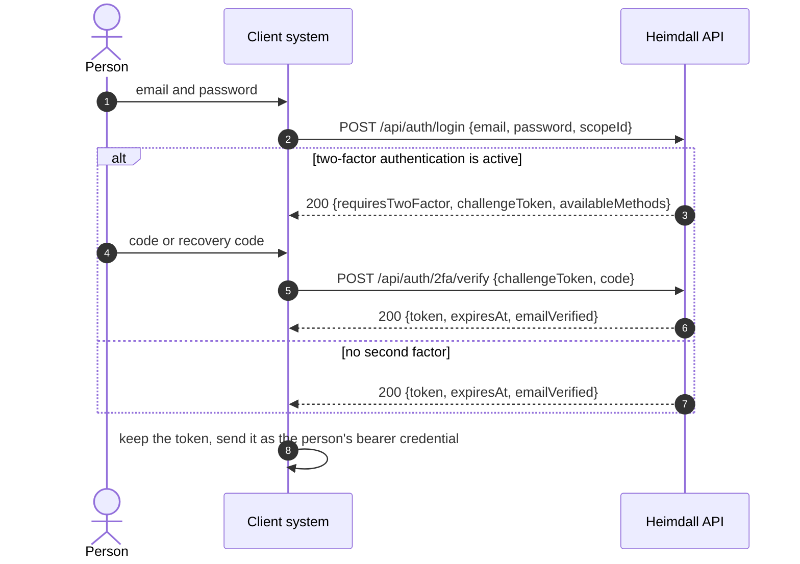
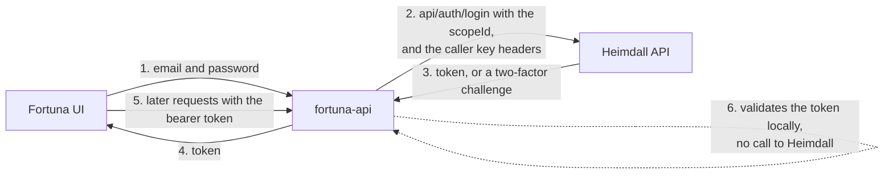

A client system is a system that does not keep its own users, passwords or
sign-in screens, and uses Heimdall for them instead. This page describes what
such a system receives from Heimdall, how it signs its users in, and what it has
to configure on each side. The terms (scope, role, person, application) are
explained in the [Overview](), and the deployment
around the API is in the [Architecture]() page.

The endpoint-level detail stays in the API's own documentation. This page links
to the relevant pages there instead of copying them.

## What a client system gets

Heimdall gives each client system one **scope**. The scope is its boundary: the
owners, users, applications, Google users and permissions of that system live in
it and are kept apart from every other client system's.

| What | What it is for the client system |
| --- | --- |
| **A scope** | The system's tenant. It has a public ID (a GUID). The scope detail screen of the UI shows the ID with a copy button, and a calling application passes it to Heimdall to create and authenticate its users. |
| **Persons** | The system's people. A person with the **User** role belongs to exactly one scope. The same email address can exist as a User in several scopes, so a User's sign-in has to name the scope. **Scope Admins** own the scope and manage its users, and a **System Admin** governs every scope. |
| **Applications** | Registered non-human identities, each in exactly one scope and each owned by a Scope Admin or System Admin who owns that scope. They represent other systems rather than people. |
| **Permissions** | Named permissions defined inside the scope. A permission flagged `IncludeAsJwtClaim` is added to the token at sign-in, so the client system reads it from the token without another call. |

A scope also carries three optional settings that matter to a client system.
Each is off or unset until someone sets it.

- **Google Sign-In** is off by default. A scope's owners switch it on before its
  people can sign in with Google.
- **Self-registration** is off by default (`SelfRegistrationEnabled`, available
  since API 1.4.0). When a scope opens it, anonymous callers can register a
  password User with `POST /api/auth/register`. The call is answered with
  `202 Accepted`, and no User exists until the person follows the emailed link.
- **Email links** (`EmailVerificationUrl` and `PasswordResetUrl`, since API
  1.4.0). By default the verification and password-reset emails link to the
  deployment's global addresses. A scope can point them at the client system's
  own `/verify-email` and `/password-reset` screens with
  `PUT /api/scopes/{id}/email-links`. Each must be an absolute `http` or `https`
  URL of at most 2048 characters, and the token is appended as a `token` query
  parameter. Those screens post the token back to `POST /api/auth/verify-email`
  and `POST /api/auth/password-reset`.

Someone has to set the scope up first. A System Admin creates it with at least
one owner, and its owners then create the persons, applications and permissions,
either in the UI (see the [User guide](), in
particular [Scopes](),
[Persons](),
[Applications]() and
[Permissions]()) or through the API.
The self-registration and email-link settings are done through the API, not the
UI.

## Authenticating

A client system signs a person in by calling Heimdall's login endpoint. Heimdall
answers with a signed JWT, which the client system then uses as the person's
credential.

- **Name the scope for a User.** `POST /api/auth/login` takes `email`,
  `password` and an optional `scopeId`. With a `scopeId`, Heimdall looks the
  person up as a User of that scope. Without one, it looks for a Scope Admin or a
  System Admin, whose emails are unique across the system.
- **One answer for every failure.** An unknown email, a wrong password, a deleted
  person, a deleted scope, a Scope Admin with no live scope and a locked-out
  account all return the same "invalid credentials" error, so the endpoint does
  not reveal which accounts exist.
- **Two-factor authentication.** When a person has an active second factor, login
  returns a short-lived challenge token instead of the access token. The challenge
  token is accepted only by `POST /api/auth/2fa/verify`, and it can be redeemed
  once. The details are in the API's
  [two-factor flow](https://artur-rios.github.io/heimdall-api/docs/flows/two-factor/).
- **Google.** A person of a scope that has switched Google Sign-In on signs in
  with `POST /api/auth/google`. See the API's
  [Google sign-in flow](https://artur-rios.github.io/heimdall-api/docs/flows/google-sign-in/).
- **Restricted identities.** An identity whose processing has been restricted can
  still sign in, but receives a subject-rights-only token that only a few
  endpoints accept. The answer says `processingRestricted: true`.

The login sequence, step by step, is in the API's
[login flow](https://artur-rios.github.io/heimdall-api/docs/flows/login/).

### The token and its claims

The token is a stateless signed JWT. Heimdall keeps no revocation list, so a
token is good until it expires. The one exception is on Heimdall's own side:
its API refuses a token whose identity has since been deleted or restricted. A
client system that validates tokens itself does not get that check. The lifetime is set by the operator with
`HEIMDALL_AUTH_TOKEN_EXPIRATION_IN_SECONDS`, which defaults to `3600` (one hour).

| Claim | Present for |
| --- | --- |
| `id` | Everyone. The person's public ID. |
| `roleId` | Everyone. |
| `scopeId` | Users only. |
| `ownedScopeIds` | Scope Admins only, comma-separated. |
| `scopePermissions` | A JSON array of permission names, when the scope has permissions flagged `IncludeAsJwtClaim`. |
| `mfaPending` | Challenge tokens only. |
| `subjectRightsOnly` | Restricted sign-ins only. |

Claims are left out rather than sent empty, and every value is a public ID, never
an internal one.

The `scopePermissions` claim is a **snapshot taken when the token is issued**. A
permission created, flagged or deleted afterwards does not change a token that is
already out, and the holder picks the change up at the next sign-in. A User
claims the flagged permissions of their scope, a Scope Admin claims those of every
scope they own, and a System Admin claims none. The API's
[scope permission claims](https://artur-rios.github.io/heimdall-api/docs/flows/scope-permission-claims/)
flow shows how a permission ends up in the token.

### Checking the token

A client system that validates Heimdall's tokens itself needs the signing
configuration they were issued with. The Heimdall API signs every token with
`HEIMDALL_AUTH_TOKEN_SECRET`, and its deployment guide says that in each VPS
environment the `fortuna-api` of that environment is given the same value. The
issuer and audience are `HEIMDALL_AUTH_TOKEN_ISSUER` and
`HEIMDALL_AUTH_TOKEN_AUDIENCE`. To rotate the secret without invalidating tokens
in flight, the operator sets `HEIMDALL_AUTH_TOKEN_SECRET_PREVIOUS` to the old
secret, waits one token lifetime, and then clears it. The procedure is in the API's
[operations](https://artur-rios.github.io/heimdall-api/docs/operations/) page.
How the shared secret fits into the deployment is described in the
[Architecture]() page, so it is not repeated
here.

## The caller key

A client system signs its users in **on their behalf**, from its own server.
Heimdall therefore sees one address, the client system's, for all of them. The
anonymous, credential-checking endpoints (login, password recovery, password
reset, email verification, Google sign-in, and second-factor verification and
resend) allow 10 requests per minute per client address, so every user of the client system ends up sharing a single
budget of ten.

The caller key lets the client system say whose request it is. Heimdall then
counts the request under that user's address instead.

| Header | Value |
| --- | --- |
| `X-Heimdall-Caller-Key` | One of the keys configured in Heimdall. |
| `X-Heimdall-Client-Address` | The end user's own IP address, IPv4 or IPv6. An IPv6 user is counted by its /64, as everywhere else in Heimdall. |

How it is set up and what to know about it:

- **On Heimdall**, the operator lists the keys in `HEIMDALL_TRUSTED_CALLER_KEYS`,
  comma-separated. Each key must be at least 32 characters, and a shorter one
  stops start-up. Unset, no caller is trusted and the headers are ignored.
- **It authenticates nobody and opens no endpoint.** The headers can only choose
  the rate-limit bucket. A wrong or missing key, or an address that does not
  parse, is not an error: the request is counted under the connection address as
  before.
- **Send the headers only from the client system's server, over TLS**, never from
  a browser or a mobile app, and keep the key in that system's secret store.
- **A named address is counted apart** from direct connections, so a key holder
  cannot spend the budget of a real caller by naming their address.
- **Rotating** needs no downtime: list both keys
  (`HEIMDALL_TRUSTED_CALLER_KEYS=<old>,<new>`), restart Heimdall, move the client
  system to the new key, then remove the old one and restart again.
- **A leaked key** lets its holder pick a bucket, which only spreads credential
  guesses over invented addresses. The per-account lockouts still count them. The
  API's [Threat Model Document](https://github.com/artur-rios/heimdall-api/blob/develop/docs/requirements/Threat%20Model%20Document.md)
  records the residual risk as TH-32.

The caller key was added in API 1.4.0. The full description is in the API's
[operations](https://artur-rios.github.io/heimdall-api/docs/operations/) page,
under the heading "A client system calling for its users".

## Example: Fortuna

[Fortuna](https://artur-rios.github.io/fortuna-docs/) is a personal-finance
system, and it is the client system the Heimdall documentation uses as its
example. Its API, `fortuna-api`, keeps no users or passwords: it registers as a
Heimdall scope and leaves identity, credentials, password recovery and
two-factor authentication to Heimdall. The Fortuna site describes the whole
system in its
[architecture page](https://artur-rios.github.io/fortuna-docs/docs/architecture/).
This section covers only the part that involves Heimdall.

- **Fortuna is one Heimdall scope.** `fortuna-api` is configured with
  `FORTUNA_HEIMDALL_BASE_URL`, which must be HTTPS, and `FORTUNA_HEIMDALL_SCOPE_ID`,
  the public ID of its scope.
- **Credential exchanges go through `fortuna-api`.** Its Heimdall gateway calls
  Heimdall's `api/auth` endpoints (`login`, `google`, `google/sign-out`,
  `2fa/verify`, `2fa/challenge/resend`, `2fa`, `2fa/enable`, `2fa/confirm`,
  `2fa/disable`, `2fa/recovery-codes/regenerate`, `password-recovery`,
  `password-reset`, `register`, `resend-verification` and `verify-email`) and
  attaches the scope ID where the endpoint takes one. Fortuna never keeps a
  password.
- **Tokens are validated locally.** After sign-in, `fortuna-api` checks each
  request's token itself, against `FORTUNA_AUTH_TOKEN_SECRET`,
  `FORTUNA_AUTH_TOKEN_ISSUER` and `FORTUNA_AUTH_TOKEN_AUDIENCE`, and does not call
  Heimdall on the request path. `FORTUNA_AUTH_TOKEN_SECRET` equals that
  environment's Heimdall signing secret, and `FORTUNA_AUTH_TOKEN_SECRET_PREVIOUS`
  covers a rotation. Its Operations & Infrastructure Document says a token
  revoked at Heimdall stays acceptable to Fortuna until it expires, which is why
  the token lifetime is configurable.
- **Claims it reads.** The identity mapper in `fortuna-api` reads the claims `id`,
  `roleId`, `scopeId` and `scopePermissions` from the token.
- **The caller key is optional.** When `FORTUNA_HEIMDALL_CALLER_KEY` is set, to
  one of Heimdall's `HEIMDALL_TRUSTED_CALLER_KEYS`, every request `fortuna-api`
  makes to Heimdall on behalf of a user carries `X-Heimdall-Caller-Key` and
  `X-Heimdall-Client-Address`. A request made outside a user's request is sent
  with neither. Without the variable nothing is sent, and the ten requests per
  minute stay shared by all of that Fortuna instance's users; once they are
  spent, Heimdall answers `429` and Fortuna passes it on to the user.
- **Email is Heimdall's.** Fortuna has no email integration of its own. The
  verification and password-recovery emails come from Heimdall, and Fortuna
  forwards the calls that ask for them. The scope's email links are what send its
  users to Fortuna's own screens.
- **If Heimdall is unreachable**, a credential exchange is answered with a
  `503` that carries no upstream details. A caller who already holds a valid
  token is not affected, because validation is local.
- **A desktop installation can run offline.** In its offline mode Fortuna uses a
  local account and talks to neither Heimdall nor anything else over the network.

The sources for this section are `fortuna-api`'s
[Operations & Infrastructure Document](https://github.com/artur-rios/fortuna-api/blob/develop/docs/requirements/Operations%20%26%20Infrastructure%20Document.md)
(its Configuration and Client IP addresses sections) and its
[Technology Stack Document](https://github.com/artur-rios/fortuna-api/blob/develop/docs/requirements/Technology%20Stack%20Document.md).

## Where to go next

- The API's [login flow](https://artur-rios.github.io/heimdall-api/docs/flows/login/),
  [two-factor flow](https://artur-rios.github.io/heimdall-api/docs/flows/two-factor/),
  [Google sign-in flow](https://artur-rios.github.io/heimdall-api/docs/flows/google-sign-in/),
  [password recovery flow](https://artur-rios.github.io/heimdall-api/docs/flows/password-recovery/),
  [person onboarding flow](https://artur-rios.github.io/heimdall-api/docs/flows/person-onboarding/)
  and [scope permission claims](https://artur-rios.github.io/heimdall-api/docs/flows/scope-permission-claims/)
  trace each path end to end.
- The [API documentation]() page maps every section of
  the API's site, including the endpoint reference.
- The [Installation]() page covers running the
  API and the UI.
