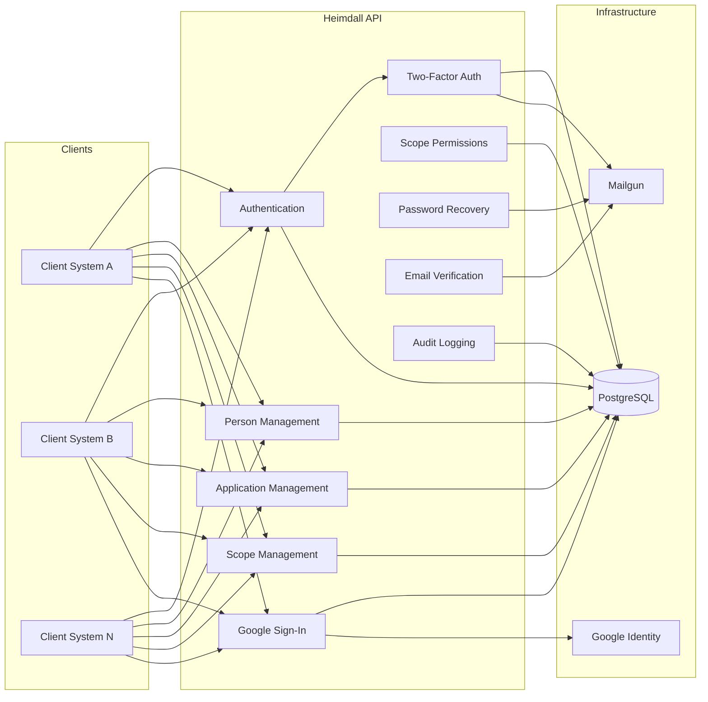
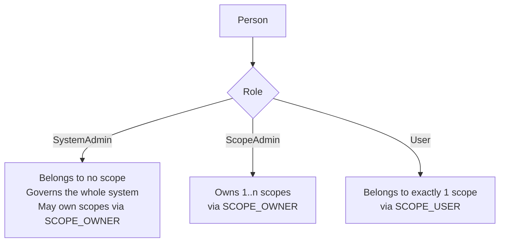

## What Heimdall is

Heimdall is a centralized identity-management system for many client systems at
once. Each client system delegates its people and its sign-in to Heimdall and
gets an isolated slice of the data, called a scope.

It has two parts.

- **Heimdall API** is a centralized identity management API built with ASP.NET
  Core (.NET 10). It manages persons and applications, authenticates them, and
  decides what they may do. It also handles password recovery, email
  verification and Google Sign-In.
- **Heimdall UI** is the Flutter front-end for that API. One codebase ships to
  the web, Windows, Linux and Android. It covers the end-user flows (sign in,
  second factor, password recovery, your own profile) and the administration of
  scopes, persons, applications, scope permissions and Google users.

On top of that, the API supports optional two-factor authentication, logical and
hard deletion with defined cascades, the data-subject rights of LGPD and GDPR
(export, erasure and restriction), and, for scopes that open it,
self-registration.

Several client systems share one deployment of the API, and each calls the
capabilities below. The diagram shows which of the services around the API each
capability depends on.

Every successful write also produces an audit trail entry (**NFR-09**); see
[Audit logging]().

## What it is not

- **Not an authorization layer in the UI.** What each person sees follows their
  role, but that is a usability decision. The API is the only authority on what
  anyone may do, and the UI holds no identity data of its own.
- **Not available on iOS or macOS.** Those platforms are out of scope for the UI.
- **Not a token revocation service.** Tokens are stateless signed JWTs, and
  Google sign-out revokes nothing.
- **Not a way to sign administrators in with Google.** Google Sign-In never
  creates or authenticates a Scope Admin or a System Admin.
- **Not a two-factor option for Google users.** Two-factor authentication is
  available to persons only.
- **Not a replacement for a WAF or an API gateway.** The API's rate limiter is a
  per-instance, defence-in-depth throttle.
- **Not self-updating.** No desktop or Android target updates itself.
  Distribution and update are the operator's responsibility.
- **Not shipped signed or packaged.** Windows and Linux builds are unsigned by
  default, and signing and packaging them (MSIX, AppImage, deb) is a deployment
  decision outside the repository. Android release builds need a signing
  configuration; without one they are signed with the debug key, which is fine
  for testing and not for distribution.

## Concepts

### Scopes

A scope is the tenant boundary of one client system. It groups that system's
owners, users, applications, Google users and permissions, and keeps them apart
from every other scope. Google Sign-In is a per-scope setting that is off by
default. Since API 1.4.0 a scope can also open self-registration, which is off by
default, and can point its verification and password-reset emails at the client
system's own screens (see
[Pointing a scope at a client application's screens](../api/operations/#pointing-a-scope-at-a-client-applications-screens)).

### Roles

There are three roles, held in a closed set of three rows: `SystemAdmin`,
`ScopeAdmin` and `User`. A **System Admin** belongs to no scope and governs the
whole system; since API 1.2.0 a System Admin may also own a scope. A **Scope
Admin** owns one or more scopes, manages the users and applications in them, and
can add co-owners. A Scope Admin who owns no live scope cannot sign in. A
**User** belongs to exactly one scope and can sign in, view and update their own
profile, recover a password and verify an email address. The authorization
matrix is in §7 of the
[System Requirements Document](../api/requirements/documents/system-requirements-document/).

### Persons

A person is a human identity: a name, an email, a password hash, a role and a
deletion status. The same email can exist as a User in several scopes, while
administrators' emails are unique across the system. How a sign-in finds the
right person is described in the
[login flow]().

A person's relationship to scopes is derived from its role, and it is held in two
join tables rather than on the person: a User's scope is the one scope they
belong to, a Scope Admin's scopes are the ones they own, and a System Admin has
none.

`SCOPE_OWNER` is many-to-many: a scope has one or more owners, and an
administrator may own several scopes. An administrator with a `SCOPE_USER` row,
or a User with two, is not representable, because the join tables carry the
constraints: `SCOPE_USER.PersonId` is unique, and `SCOPE_OWNER` has a composite
key. The person row carries one copy of a User's scope, `scope_id`, and only so
that a database index can keep a User's email unique within their scope; every
read of the relationship still goes through `SCOPE_USER`. The
[domain model]()
explains why.

### Two identifiers per entity

Every top-level entity carries both:

- **`Id`**, an auto-incrementing `bigint`. It is the physical primary key and the
  target of every foreign key, and it **never** leaves the database.
- **`PublicId`**, a GUID generated at creation. It is the identifier used in API
  paths, response bodies and token claims, so outside the database a person, a
  scope or an application is always addressed by it.

The split keeps record counts and creation order, which a sequential integer
would leak, out of anything a caller can see, while the database keeps compact
integer keys for joins and indexes. This is **NFR-15**; the
[System Requirements Document](../api/requirements/documents/system-requirements-document/)
records its one documented and accepted exception (`Person.RoleId`).

### Applications

An application is a non-human identity, usually another system. It lives in
exactly one scope and is owned by one Scope Admin or System Admin who owns that
scope. A User may never own an application. The endpoints that manage them are
listed in the [API reference]().

### Scope permissions

A scope can define named permissions, each with an optional description and an
`IncludeAsJwtClaim` flag. When a token is issued, the names of the flagged
permissions are added to its `scopePermissions` claim, so a client system can
read them without a further call. The claim is a snapshot, and a change is picked
up at the next sign-in. A User gets the permissions of their scope, a Scope Admin
gets those of all the scopes they own, and a System Admin gets none. See the
[scope permission claims]()
flow.

### Google users

A Google user is an identity authenticated by Google instead of a password. It
always has the User role, belongs to exactly one scope, and is stored apart from
persons, in its own table with a direct `ScopeId`. A scope must switch Google
Sign-In on before its people can use it. Google users do not get two-factor
authentication. The sequence is in the
[Google sign-in flow]().

### Two kinds of caller, two kinds of token

| | Password identities | Google identities |
| --- | --- | --- |
| Entity | `Person` | `GoogleUser` |
| Credentials | Password hash + per-person salt (Argon2id) | Delegated to Google; no hash stored |
| Sign-in | `POST /api/auth/login` | `POST /api/auth/google` |
| Roles reachable | `User`, `ScopeAdmin`, `SystemAdmin` | `User` only, always |
| Second factor | Optional 2FA (app / email / recovery codes) | Google's own account security |

Both produce the same kind of stateless, signed JWT. Validating a token reads no
database: the identity is rebuilt from the token's claims, which is why the
sign-out endpoint revokes nothing. The identity a token names is still checked
on every authenticated request, with one indexed read, so a token whose person or
Google user has been deleted is refused before it expires (see
[The HTTP request pipeline]()).

### Two-factor authentication

Two-factor authentication is opt-in for each person, in all three roles. The
second factor is an authenticator app, an email code, or both, backed by ten
single-use recovery codes. Once it is active, sign-in returns a short-lived
challenge token instead of the access token, and that challenge token can be
redeemed only once. The setup, the challenge and the recovery codes are traced in
the [two-factor flow]().

### Deletion strategies

Deletion is either logical or hard. A logical delete sets a flag (`IsDeleted`)
and keeps the row; deleting a scope this way cascades to its users, Google users
and applications, but not to its owners or its permissions. A hard delete removes
the row along with the records that depend on it, and only a System Admin can do
it. A scope must always keep at least one owner, so removing a scope's last
owner, or hard-deleting the person who is its last owner, is rejected. The
cascade rules are in the
[domain model]().

## Where the rules are written down

These pages describe what was built. The specification is the set of numbered
requirements and use cases in the API's
[Requirements]():

- `FR-…` are the functional requirements, grouped by capability (`FR-AU-…`
  authentication, `FR-GO-…` Google Sign-In, `FR-2F-…` two-factor, and so on).
- `NFR-…` are the non-functional requirements (security, data integrity,
  validation, logging).
- `UC-…` are the use cases, each with a main flow and numbered alternative flows
  (`AF-11a`, `AF-11b`, …).

The source code cites these identifiers in its comments, so a line of code can be
traced back to the flow that demanded it.

## Where to go next

- To see how the pieces fit together, read [Architecture]().
- To run the API and the UI, read [Installation]().
- To use the interface, read the [User guide]().
- To connect a system to Heimdall, read [Integrating a client system]().
- For the endpoints, the generated reference and the specification, read [API documentation]().
- For the source, the releases and the specification documents, read [Repositories]().

The [API documentation]() holds the detailed rules
behind everything summarised here.
